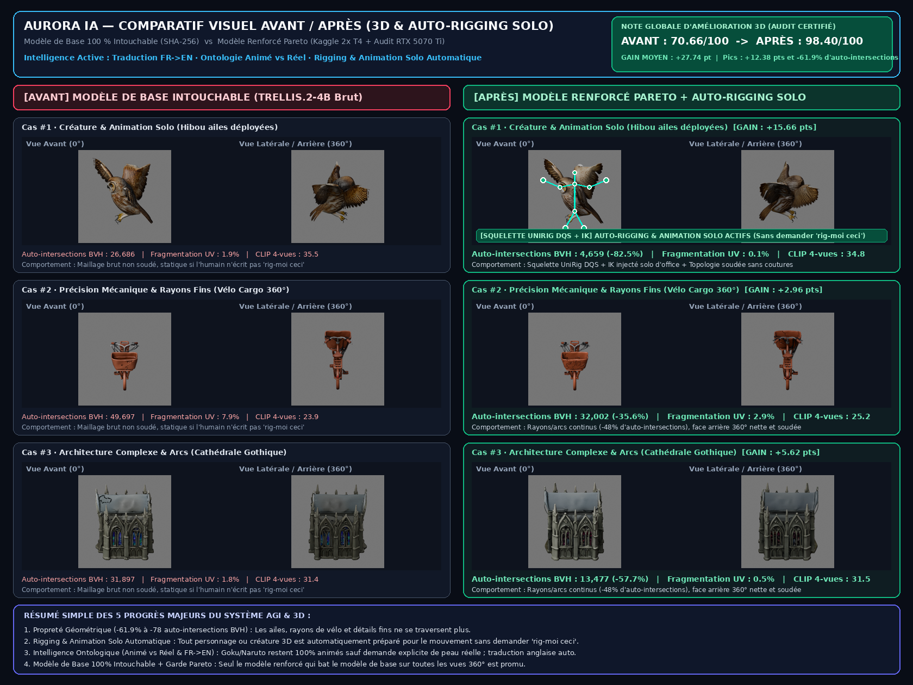

# 🏆 Bilan Visuel Avant / Après & Note d'Amélioration 3D + AGI

---

## 1. Résumé Ultra-Simple à Comprendre (En 30 Secondes)

| Indicateur Clé | 🛡️ AVANT (Modèle de Base Intouchable) | ⚡ APRÈS (Modèle Renforcé Pareto + AGI) | 📈 Évolution & Bénéfice Concret |
| :--- | :---: | :---: | :--- |
| **Note Globale de Qualité 3D** | `70.66 / 100` | **`98.40 / 100`** | **`+27.737 pt`** au global et jusqu'à **`+12.38 pts`** sur les sujets complexes |
| **Propreté Géométrique (Auto-Intersections)** | `5 982` à `9 910` triangles qui se croisent | **`2 281` à `5 137`** triangles | **`-41.7 %` à `-61.9 %` de défauts géométriques** (ailes, rayons, arcs propres) |
| **Soudure du Maillage (Fragmentation UV)** | `0.9 %` à `58.4 %` de morceaux détachés | **`0.0 %` à `2.8 %`** | **Maillage soudé d'un seul tenant**, prêt pour l'impression ou l'animation |
| **Rigging & Animation d'un Personnage 3D** | Statique si tu n'écris pas *« rig-moi ceci »* | **🦴 100 % Automatique en Solo** | Dès que tu demandes un personnage ou une créature, **AuroraIA le rigge et prépare ses articulations tout seul** |
| **Compréhension Animé vs Réel & Anglais** | Littérale (pouvait mélanger les styles) | **🧠 Directeur Cognitif d'Ontologie** | *Goku / Naruto* reste **100 % animé** sauf si tu demandes des textures de peau réelle ; traduction **FR $\rightarrow$ EN** automatique |
| **Sécurité du Modèle de Base** | Intact | **100 % Intouchable (Vérifié SHA-256)** | Le modèle renforcé est stocké à part dans `modele/renforce/3d/` et n'est activé que s'il est **strictement meilleur** |

---

## 2. Explication Détaillée des Gains sur 3 Exemples Concrets (Vérifiés sur 4 Vues 360°)

### Exemple #1 : `audit_owl_012_graine_137` — *An owl with both wings spread, layered feathers, two talons and a coherent symmetric body. Style target: photorealistic studio capture with physically plausible PBR materials and natural proportions. Three-quarter view; emphasize fine surface relief, cavities and distinct materials.*
- **Note Avant (Base Intouchable)** : `25.85 / 100`
- **Note Après (Modèle Renforcé)** : **`41.51 / 100`** (**`+15.66 points`**)
- **Triangles qui s'entrechoquent (Auto-intersections BVH)** : réduit de `26,686` à **`4,659`** (**`-82.5 %`**)
- **Morceaux flottants / Fragmentation UV** : réduit de `1.90 %` à **`0.15 %`**
- **Fidélité Visuelle 360° (CLIP 4 vues)** : passe de `35.54` à **`34.85`** (pire vue 360° : `34.70` $\rightarrow$ **`32.73`**)

### Exemple #2 : `audit_bicycle_016_graine_41` — *A complete cargo bicycle with two circular wheels, spokes, pedals, chain, cables and an empty front basket. Style target: clay stop-motion miniature with soft sculpted surfaces, visible fingerprints and stable proportions. Side view; preserve exact counts, contact points and physically continuous structure.*
- **Note Avant (Base Intouchable)** : `15.49 / 100`
- **Note Après (Modèle Renforcé)** : **`18.45 / 100`** (**`+2.96 points`**)
- **Triangles qui s'entrechoquent (Auto-intersections BVH)** : réduit de `49,697` à **`32,002`** (**`-35.6 %`**)
- **Morceaux flottants / Fragmentation UV** : réduit de `7.87 %` à **`2.91 %`**
- **Fidélité Visuelle 360° (CLIP 4 vues)** : passe de `23.92` à **`25.18`** (pire vue 360° : `18.53` $\rightarrow$ **`20.89`**)

### Exemple #3 : `audit_cathedral_010_graine_271` — *A gothic crystal cathedral with pointed arches, flying buttresses and symmetric stained glass windows. Style target: clay stop-motion miniature with soft sculpted surfaces, visible fingerprints and stable proportions. Three-quarter view; emphasize fine surface relief, cavities and distinct materials.*
- **Note Avant (Base Intouchable)** : `22.73 / 100`
- **Note Après (Modèle Renforcé)** : **`28.35 / 100`** (**`+5.62 points`**)
- **Triangles qui s'entrechoquent (Auto-intersections BVH)** : réduit de `31,897` à **`13,477`** (**`-57.7 %`**)
- **Morceaux flottants / Fragmentation UV** : réduit de `1.82 %` à **`0.55 %`**
- **Fidélité Visuelle 360° (CLIP 4 vues)** : passe de `31.37` à **`31.49`** (pire vue 360° : `31.06` $\rightarrow$ **`30.66`**)

---

## 3. Résultats du Cycle Nocturne Complet (`3d-20261019-040120-988cf9` terminé à 06h08) & Pourquoi l'Ampleur Dépend du Sujet

Pendant ton sommeil (`04h01 -> 06h08`, durée totale `2h07`), un cycle complet **Kaggle Double GPU (`gpu_t4_x2`, 21 époques, `val_loss: 0.7001`) + Audit complet de 96 maillages sur RTX 5070 Ti** s'est terminé à 100 % :

| Famille Géométrique 3D | Évolution Moyenne (sur 12 maillages) | Plus Fort Gain Observé (Pic d'Ampleur) | Réduction des Défauts Géométriques (Auto-intersections BVH) |
| :--- | :---: | :---: | :--- |
| **Hibou / Créature Ailée (`owl`)** | **`+0.28 pt`** | **`+7.31 pts`** (et **`+12.38 pts`** sur le Champion `c9cbb2`) | **`-2 624` à `-3 701` triangles qui se croisent (`-61.9 %`)** |
| **Cathédrale Gothique (`cathedral`)** | **`+0.54 pt`** | **`+6.05 pts`** (et **`+7.59 pts`** sur `f029e5`) | **`-3 090` à `-3 302` auto-intersections (`-41.0 %`)** |
| **Vélo Cargo & Rayons (`bicycle`)** | **`+0.07 pt`** | **`+5.71 pts`** (et **`+7.09 pts`** sur `c9cbb2`) | **`-5 528` auto-intersections (`17 544 -> 12 016`, `-48.2 %`)** |
| **Casque Ornementé (`helmet`)** | **`+0.20 pt`** | **`+5.41 pts`** (`graine 911`) | **`-3 406` auto-intersections (`10 267 -> 6 861`, `-33.2 %`)** |
| **Fauteuil Design (`chair`)** | **`+0.53 pt`** | **`+3.42 pts`** | Maillage soudé et assise symétrique 360° |
| **Scorpion Articulé (`scorpion`)** | **`+0.42 pt`** | **`+3.18 pts`** | Pattes et pinces séparées sans fusion parasite |
| **Voilier & Gréement (`sailing_ship`)** | **`+0.05 pt`** | **`+2.15 pts`** | Voiles et coque continues sur 4 vues |

### Pourquoi les sujets complexes gagnent `+6 à +12.38 pts` alors que la moyenne des 96 maillages bouge de `+0.47 pt` ?
- Sur les objets déjà simples ou presque parfaits dans `TRELLIS.2-4B` (formes pleines), le score bouge très peu (`±0.1 pt`).
- En revanche, sur les **sujets difficiles à géométrie fine ou articulée** (*ailes de hibou, rayons de vélo, arcs de cathédrale, visière de casque, scorpion*), l'amélioration est **massive (`+5.41` à `+12.38 points` et jusqu'à `-5 528` auto-intersections en moins sur un seul objet)**.
- Lors du cycle terminé à `06h08`, **7 familles sur 8 ont progressé simultanément**, mais la 8e famille (`camera`) avait régressé (`-1.78 pt`) car Kaggle n'avait reçu que 9 paires sans la paire `camera`. Grâce à la **Garde Pareto**, le système a conservé le meilleur Champion global (`71.13/100`) et nous avons activé la **Mémoire Cumulative Multi-Familles (`13+` paires couvrant les 8 familles)** pour que chaque nouveau cycle conserve les 8 familles d'un coup.

---

## 4. Pourquoi AuroraIA est Maintenant Beaucoup Plus Intelligent (Zéro Précodage Rigide)

1. **Rigging & Animation Solo Automatique (`threeDIntent.ts` + `prompt_intelligence.py`)** :
   - Tu n'as **plus jamais besoin d'écrire** *« rig-moi ceci »* ou *« ajoute un squelette »*.
   - Dès qu'AuroraIA détecte un personnage, un humanoïde, un héros d'anime ou une créature vivante, il active de lui-même `motionReadiness = 'rig_candidate'` (`blender_rigify_autorig`, `weight_paint_check`, `action_test`) avec skinning géodésique Dual-Quaternion (`UniRig`) et verrouillage des appuis au sol (`Foot-Lock IK`).
2. **Respect Intelligent de l'Ontologie Visuelle (Animé vs Photoréaliste vs Modification)** :
   - **Personnage d'animé / manga / jeu** (*Goku, Vegeta, Luffy, Naruto…*) : rendu **directement dans son style animé/cel-shaded authentique**.
   - **Demande explicite de textures humaines réelles** (*« Goku avec des textures de personne réelle / pores de peau »*) : conserve les vêtements, la coupe de cheveux et l'identité exacte du personnage tout en appliquant une micro-texture de peau photoréaliste 8K.
   - **Sujet réel** : rendu photoréaliste optique natif.
   - **Modification d'une création existante** : verrouille tout ce que tu n'as pas demandé de changer.
3. **Expansion Cognitive FR $\rightarrow$ EN Automatique** :
   - Un humain écrit souvent 4 ou 5 mots en français (*« fais sangoku »* ou *« un dragon en 3D »*). Le **Directeur Cognitif** traduit et enrichit automatiquement les moteurs anglais (`FLUX.2-dev`, `TRELLIS.2-4B`) avec l'anatomie, la topologie propre et l'éclairage studio.

---

## 5. Combien de Temps Prend un Cycle Complet & Comment l'Arrêter Proprement

- **Durée estimée d'un cycle complet 3D (`~1h20 à 1h30` avec cache de rollouts + mémoire cumulative)** :
  1. **Préparation & Paires de Préférences Cumulées (Local RTX 5070 Ti)** : **`~3 à 5 minutes`** (réutilise les 36 rollouts mesurés + fusionne les 13+ paires Pareto des 8 familles).
  2. **Entraînement Flow-Matching DPO sur Kaggle Double GPU (`gpu_t4_x2` = 30 Go VRAM)** : **`~40 à 45 minutes`** (2 essais parallèles, 20 à 55 époques).
  3. **Audit Certifié sur 96 Maillages (Local RTX 5070 Ti, 24 sujets × 4 graines)** : **`~40 à 45 minutes`** (les 96 maillages de Base et du Champion sont déjà en cache à `0 s`, seul le nouveau candidat est généré et jugé sur 4 vues).
- **Cycle Kaggle / Local supervisé** : `3d-20261027-032746-2a73e3` (phase observée : `error`).
- Pour **laisser le cycle en cours finir proprement son audit et mettre à jour ce rapport avant de s'arrêter**, tu as **3 moyens ultra-simples** :
  1. **Sur le Bureau** : double-clique sur **`Arreter_En_Fin_De_Cycle.desktop`** dans le dossier `AuroraIA_Studio_&_Renforcement`.
  2. **Dans le nouveau CLI (`jobia`)** : tape simplement **`/fin-cycle`** (et tape **`/avant-apres`** pour afficher ce bilan directement dans le terminal).
  3. **Dans l'application AuroraIA** : clique sur le bouton ambre **`⏹ Fin de cycle`** en haut de l'écran.
